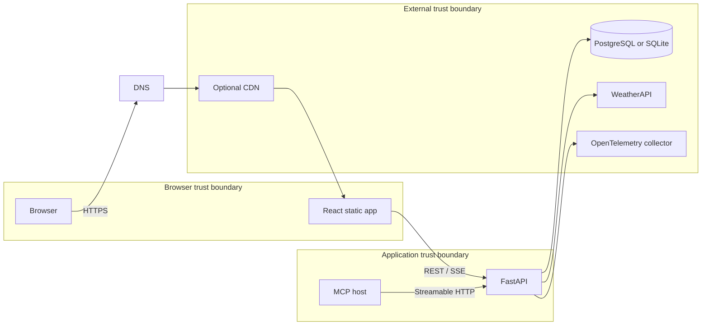

# ChiPark

ChiPark is a park service-status and incident-tracking application for real
Chicago park data sourced from the City of Chicago Data Portal.
It combines React and TypeScript with a FastAPI backend, a relational
database, Google sign-in, live notifications, third-party weather data,
OpenTelemetry, and an MCP server.

## Deliverables

| Deliverable | Location |
| --- | --- |
| Application runbook | [RUNBOOK.md](RUNBOOK.md) |
| Backend documentation | [backend/README.md](backend/README.md) |
| Frontend documentation | [frontend/README.md](frontend/README.md) |
| MCP configuration | [.mcp.json](.mcp.json) |

## Architecture



The browser receives public park and ticket resources and sends credentials
only to authenticated API routes.  
The backend validates bearer tokens, applies
role checks, and owns database and third-party API access.  
MCP tools use the
same application authentication service and role rules as the REST API.

## Technology

- Frontend: React 19, TypeScript, Vite
- Backend: Python 3.11+, FastAPI, SQLAlchemy
- Database: PostgreSQL in deployment; SQLite or PostgreSQL for local development and tests
- Authentication: opaque bearer tokens and Google OpenID Connect
- Live updates: server-sent events
- MCP: Streamable HTTP MCP server
- Observability: OpenTelemetry OTLP plus Grafana Faro
- Data source: City of Chicago park data and WeatherAPI; synthetic account,
  ticket, and notification data

Park records come from real City of Chicago park data.  
Account, ticket, and
notification examples are synthetic.

## Clean-machine setup

Prerequisites:

- Git
- Python 3.11 or later
- [uv](https://docs.astral.sh/uv/) (can be installed with pip)
- Node.js 24 and npm
- PostgreSQL (Optional)

Clone and install:

```console
git clone https://github.com/matt-manes/chipark
uv sync --project backend --locked
npm --prefix frontend ci
```

If PostgreSQL is not installed on the machine (only Sqlite support):

```console
git clone https://github.com/matt-manes/chipark
uv sync --project backend --locked --no-default-groups
npm --prefix frontend ci
```

The PostgreSQL group only controls which database drivers are installed.
Database selection is controlled by `CHIPARK_DATABASE` in `backend/.env`.  
Installing the PostgreSQL dependencies allows the backend to use SQLite or
PostgreSQL by changing that environment variable.  
The `--no-default-groups` installation supports SQLite only.  

Create local configuration:

```console
uv run --project backend --no-sync python -m backend.scripts.new_env
```

Fill `backend/.env` with development-only values.  
Set
`CHIPARK_DATABASE=sqlite` for SQLite or `CHIPARK_DATABASE=postgresql` for PostgreSQL.  
The complete list and deployment procedure are documented in
[RUNBOOK.md](RUNBOOK.md).

Populate the local database:

```console
uv run --project backend --no-sync python -m backend.scripts.populate_all_data
```

Start the backend:

```console
uv run --project backend --no-sync uvicorn backend.app:app --reload --host 127.0.0.1 --port 8000
```

Start the frontend in another terminal:

```console
npm --prefix frontend run dev
```

Open `http://localhost:5173`.  

## Test commands

Run the complete backend suite from the repository root:

```console
uv run --project backend --no-sync coverage-suite
```

The coverage suite executes pytest, prints a coverage report, and writes
`htmlcov/index.html`.

Run the frontend unit tests:

```console
npm --prefix frontend test
```

Run the strict TypeScript build and MCP App build:

```console
npm --prefix frontend run build
```

Run the backend quality checks (formatting and linting):

```console
uv run --project backend --no-sync quality-checks
```

## API

Public routes include:

- `GET /`
- `GET /parks`
- `GET /parks/{park_id}`
- `GET /parks/{park_id}/conditions`
- `GET /tickets`
- `GET /tickets/{ticket_id}`

Authentication routes include registration, login, logout, profile management,
and Google sign-in callbacks under `/auth`.  
Authenticated notification routes are under `/notifications`, including a
server-sent event stream at `/notifications/stream`.  
Administrator account management is under `/admin/users`.  

The FastAPI OpenAPI page is available at `/docs` in a running backend.  

## Data and authorization

The database supports primary-keyed SQLAlchemy entities, foreign keys,
repository-backed persistence, and indexed lookups.  
The application creates
its tables through SQLAlchemy metadata when it starts.

There are viewer and administrator roles.  
Anonymous write requests are rejected
with `401`; account and ticket administration require the administrator role
and rejects a viewer or other non-administrator caller with `403`.  

Ticket mutations create notifications for the submitter in the same database
transaction.  
Notification records preserve the recipient and notification
identity and support append-like event delivery.  

## MCP

The MCP endpoint is `/mcp`.  
The repository MCP configuration currently targets
`http://127.0.0.1:8000/mcp` for local use.

Read tools:

- `list_tools`
- `list_parks`
- `list_tickets`
- `get_park`

Write tools:

- `submit_ticket`
- `close_ticket`
- `edit_ticket`
- `delete_ticket`

Ticket submission requires an authenticated account.  
Administrative ticket operations require an administrator account.  
MCP tool calls use the same bearer-token authentication service as REST routes.  
The interactive MCP App is
built as part of `npm --prefix frontend run build` and served from
`frontend/dist/mcp-app/mcp-app.html` although it is untested because the GitHub copilot app doens't support mcp apps.  
