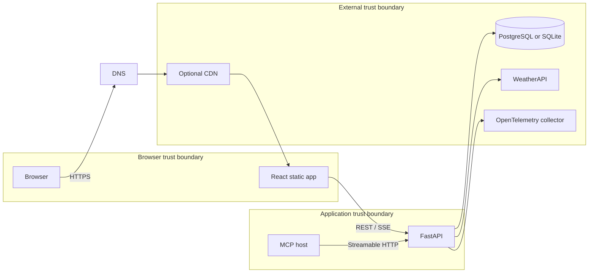
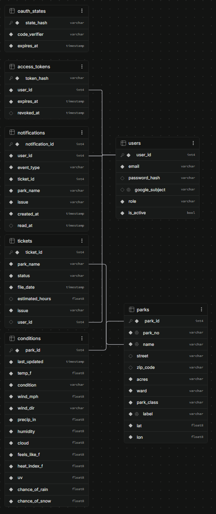
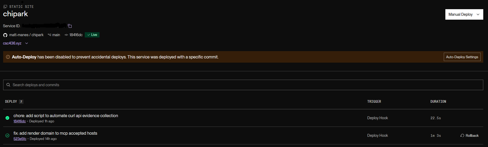
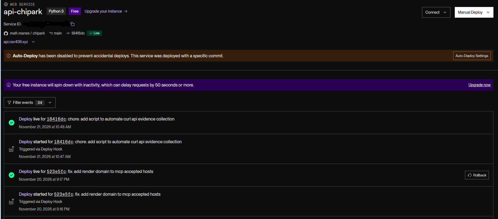

# ChiPark

**CSC436 Final Project**  

ChiPark is a park service-status and incident-tracking application for real
Chicago park data sourced from the City of Chicago Data Portal.  
It combines React and TypeScript with a FastAPI backend, a relational
database, Google sign-in, live notifications, third-party weather data,
OpenTelemetry, and an MCP server.

## Deliverables

| Deliverable | Location |
| --- | --- |
| Application runbook | [RUNBOOK.md](RUNBOOK.md) |
| Backend documentation | [backend/README.md](backend/README.md) |
| Frontend documentation | [frontend/README.md](frontend/README.md) |

## Architecture



The browser receives public park and ticket resources and sends credentials
only to authenticated API routes.  
The backend validates bearer tokens, applies
role checks, and owns database and third-party API access.  
MCP tools use the
same application authentication service and role rules as the REST API.

## Technology

- Frontend: React 19, TypeScript, Vite
- Backend: Python 3.11+, FastAPI, SQLAlchemy
- Database: PostgreSQL in deployment; SQLite or PostgreSQL for local development and tests
- Authentication: opaque bearer tokens and Google OpenID Connect
- Live updates: server-sent events
- MCP: Streamable HTTP MCP server
- Observability: OpenTelemetry OTLP plus Grafana Faro
- Data source: City of Chicago park data and WeatherAPI; synthetic account,
  ticket, and notification data

Park records come from real City of Chicago park data.  
Account, ticket, and
notification examples are synthetic.

## Clean-machine setup

Prerequisites:

- Git
- Python 3.11 or later
- [uv](https://docs.astral.sh/uv/) (can be installed with pip)
- Node.js 24 and npm
- PostgreSQL (Optional for development)

Clone and install:

```console
git clone https://github.com/matt-manes/chipark
uv sync --project backend --locked
npm --prefix frontend ci
```

If PostgreSQL is not installed on the machine (only Sqlite support):

```console
git clone https://github.com/matt-manes/chipark
uv sync --project backend --locked --no-default-groups
npm --prefix frontend ci
```

The PostgreSQL group only controls which database drivers are installed.  
Database selection is controlled by `CHIPARK_DATABASE` in `backend/.env`.  
Installing the PostgreSQL dependencies allows the backend to use SQLite or
PostgreSQL by changing that environment variable.  
The `--no-default-groups` installation supports SQLite only.  

Create local configuration:

```console
uv run --project backend --no-sync python -m backend.scripts.new_env
```

Fill `backend/.env` with development-only values.  
Set
`CHIPARK_DATABASE=sqlite` for SQLite or `CHIPARK_DATABASE=postgresql` for PostgreSQL.  
The complete list and deployment procedure are documented in [RUNBOOK.md](RUNBOOK.md).  

Populate the local database:

```console
uv run --project backend --no-sync python -m backend.scripts.populate_all_data
```

Start the backend:

```console
uv run --project backend --no-sync uvicorn backend.app:app --reload --host 127.0.0.1 --port 8000
```

Start the frontend in another terminal:

```console
npm --prefix frontend run dev
```

Open `http://localhost:5173`.  

## Test commands

Run the complete backend suite from the repository root:

```console
uv run --project backend --no-sync coverage-suite
```

The coverage suite executes pytest, prints a coverage report, and writes `htmlcov/index.html`.  

Run the frontend unit tests:

```console
npm --prefix frontend test
```

Run the strict TypeScript build and MCP App build:

```console
npm --prefix frontend run build
```

Run the backend quality checks (formatting and linting):

```console
uv run --project backend --no-sync quality-checks
```

## API

Public routes include:

- `GET /`
- `GET /parks`
- `GET /parks/{park_id}`
- `GET /parks/{park_id}/conditions`
- `GET /tickets`
- `GET /tickets/{ticket_id}`

Authentication routes include registration, login, logout, profile management,
and Google sign-in callbacks under `/auth`.  
Authenticated notification routes are under `/notifications`, including a
server-sent event stream at `/notifications/stream`.  
Administrator account management is under `/admin/users`.  
Ticket responses expose the submitter's `user_id` only to administrators; for other callers it is `null`.  

REST error responses use a `detail` array of objects with `type`, `loc`, `msg`, and `input` fields.  
Validation errors identify the affected input; other HTTP errors use an empty location and a null input.  

The FastAPI OpenAPI page is available at `/docs` in a running backend if the env var `CHIPARK_ENABLE_DOCS` is set to `true` or the var isn't present.  

**API evidence:**

Located in [curl_api_transcript.txt](assets/curl_api_transcript.txt).  
Collected using `uv run --project backend python -m backend.scripts.api_evidence --base-url http://127.0.0.1:8000 --output assets/curl_api_transcript.txt`
from repo root against a local backend server instance with a populated SQLite database.  
This covers every route with successes and intentional failures across the roles of anonymous users, registered non-admin users, and admin users (50+ curl requests).  
These are also covered by the automated backend test suite (250+ tests).  

Due to the number of requests involved, the `CHIPARK_RATE_LIMIT_AUTH` and `CHIPARK_RATE_LIMIT_GLOBAL` should be set to something high like `1000/minute` to avoid hanging if attempting to reproduce the evidence.  
This also means this transscript does not show rate-limiting evidence.  

Rate limit evidence was captured using `uv run --project backend python -m backend.scripts.rate_limit_evidence --base-url http://127.0.0.1:8000 --output assets/rate_limit_transcript.txt`
from repo root against a local backend server instance with a populated SQLite database and `CHIPARK_RATE_LIMIT_AUTH=5` and `CHIPARK_RATE_LIMIT_GLOBAL=10`.  
The transscript is in [rate_limit_transcript.txt](assets/rate_limit_transcript.txt).  

## Data and authorization

The database supports primary-keyed SQLAlchemy entities, foreign keys, repository-backed persistence, and indexed lookups.  
The application creates its tables through SQLAlchemy metadata when it starts.  

There are viewer and administrator roles.  
Anonymous write requests are rejected with `401`; account and ticket administration require the administrator role
and rejects a viewer or other non-administrator caller with `403`.  

Ticket mutations create notifications for the submitter in the same database transaction
Notification records preserve the recipient and notification
identity and support append-like event delivery.  

Database schema taken from deployed Supabase instance:  


## MCP

The MCP endpoint is `/mcp`.  
The repository MCP configuration currently targets
`http://127.0.0.1:8000/mcp` for local use, but can also be added from the live deployment at `https://api.csc436.xyz/mcp`.  

Read tools:

- `list_tools`
- `list_parks`
- `list_tickets`
- `get_park`

Write tools:

- `submit_ticket`
- `close_ticket`
- `edit_ticket`
- `delete_ticket`

Ticket submission requires an authenticated account.  
Administrative ticket operations require an administrator account.  
MCP tool calls use the same bearer-token authentication service as REST routes.  
The interactive MCP App is built as part of `npm --prefix frontend run build` and served from
`frontend/dist/mcp-app/mcp-app.html` although it is untested because the GitHub copilot app doens't support mcp apps.  

## Automated deployment

The [GitHub Actions deployment workflow](.github/workflows/deploy.yml) runs when a commit is pushed to `main`.  
It uses the `production` environment and the `RENDER_BACKEND_HOOK_URL` and `RENDER_FRONTEND_HOOK_URL` secrets to trigger Render deployments for the pushed commit.  

See the [runbook](RUNBOOK.md#redeploy-to-render-on-commit) for setup.  

Screenshots from Render showing automated deployment via deploy hook url for both frontend and backend:

Frontend:


Backend:


## DNS and TLS

Transcripts for `dig +trace` and cert inspection are in [dig_trace.txt](assets/dig_trace.txt) and [cert_inspection.txt](assets/cert_inspection.txt), respectively.  

## CORS

Transcripts for two preflight requests (OPTIONS) are in [cors_transcript.txt](assets/cors_transcript.txt).  
One uses an origin of `https://csc436.xyz` is successful while the seconds uses an origin of `https://api.csc436.xyz` and is unsuccessful.  
The allowed CORS list used in production can be seen in the provided `.env` file.  

## Cloudflare CDN and caching

The frontend is served by Render's static-site CDN, while Cloudflare proxies the API hostname to the Render backend.  
The [runbook](RUNBOOK.md#6-domains-and-caching) describes cache rules for public
park GET requests and bypassing authenticated, changing, and streaming requests.  

[cache_transcript.txt](assets/cache_transcript.txt) contains two curl requests to the same endpoint with the first
showing a cache MISS and the second showing a cache HIT as well as other Cloudflare headers (proving caching and Cloudflare proxying).  

## OpenTelemetry and Grafana

The backend uses OpenTelemetry to instrument FastAPI and SQLAlchemy and can
export traces, metrics, and logs to Grafana Cloud over OTLP/HTTP.  
Grafana Faro captures browser telemetry and propagates trace context to the backend.  
See the [runbook](RUNBOOK.md#opentelemetry-and-grafana-cloud) for configuration.  
